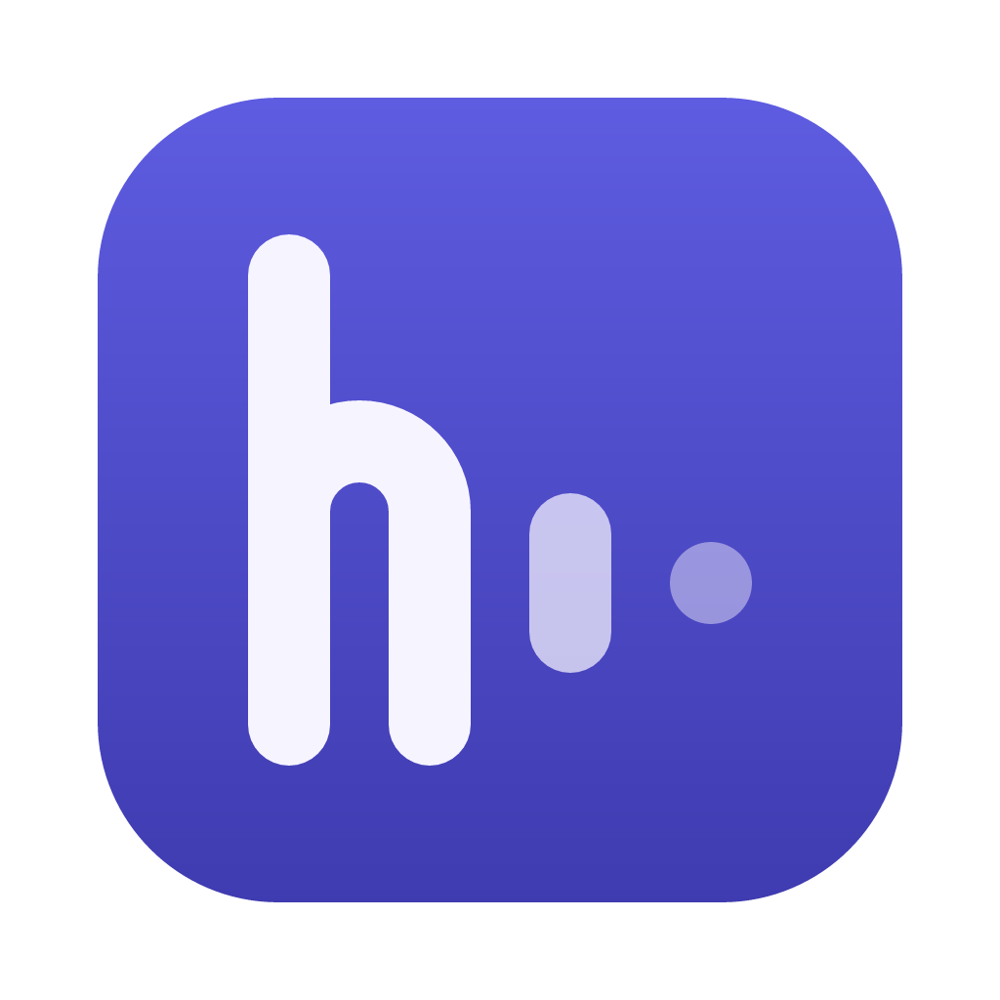
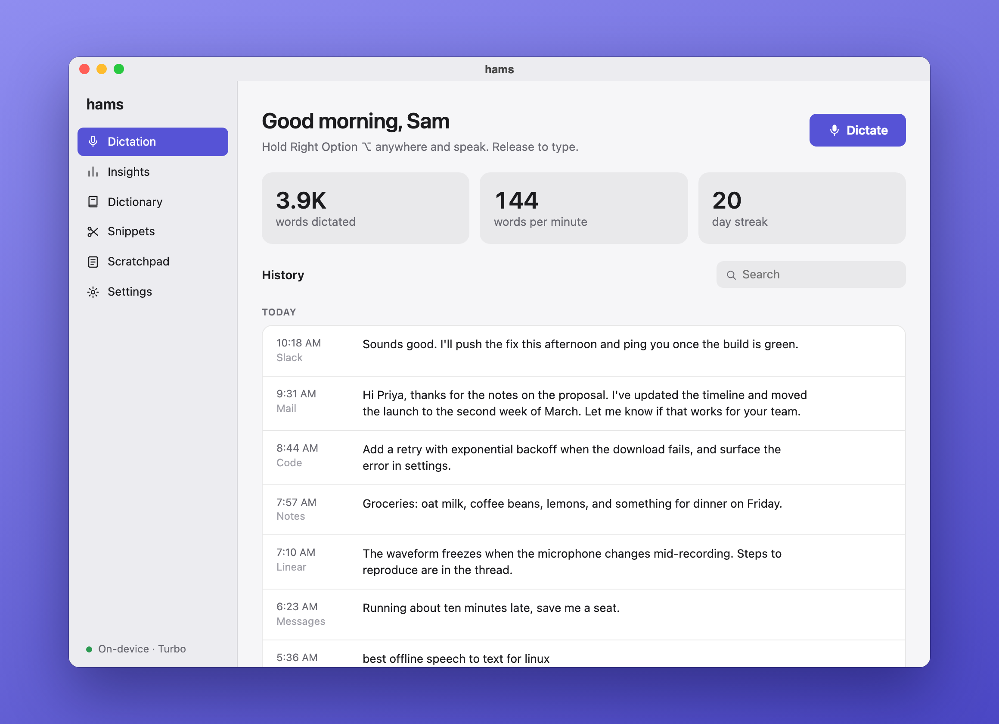
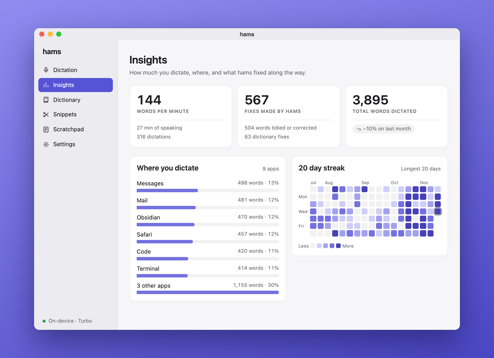
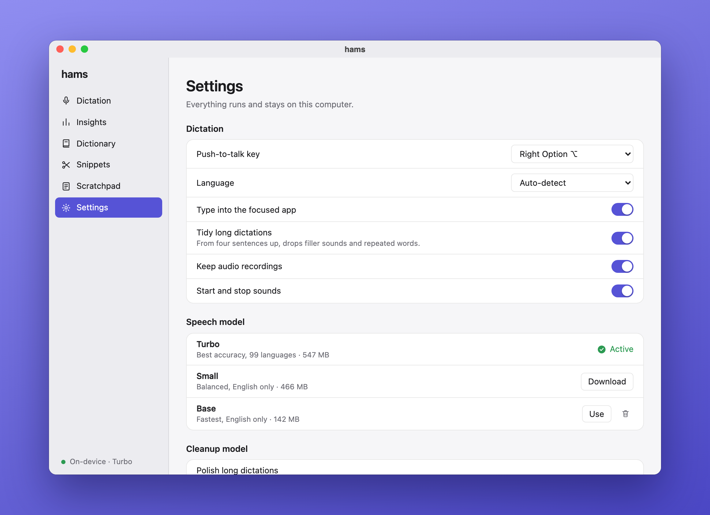
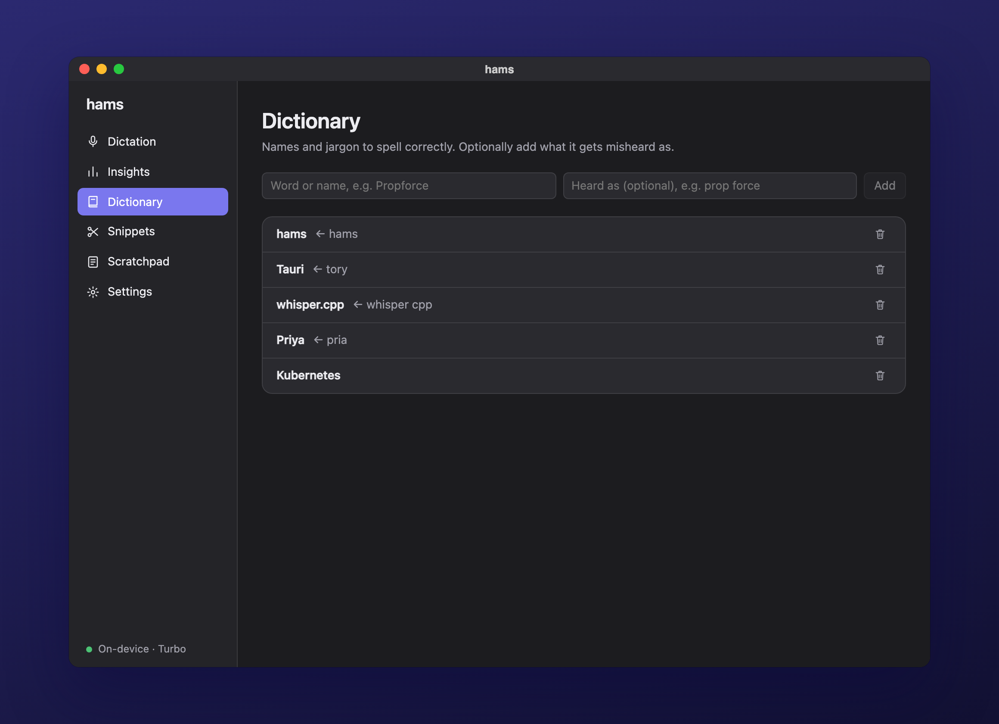

<p align="center">
  
</p>

<h1 align="center">hams</h1>

<p align="center">
  <strong>Private, offline voice dictation for macOS and Linux.</strong><br>
  Hold a key, speak, let go: the text is typed into whatever app has focus.
</p>

<p align="center">
  <a href="https://github.com/muneebsajjad/hams/actions/workflows/ci.yml"></a>
  <a href="LICENSE"></a>
  
  
</p>

<p align="center">
  <picture>
    <source media="(prefers-color-scheme: dark)" srcset="docs/screenshots/home-dark.png">
    
  </picture>
</p>

Speech recognition runs on this machine with [whisper.cpp](https://github.com/ggml-org/whisper.cpp),
and an optional small language model ([llama.cpp](https://github.com/ggml-org/llama.cpp)) cleans up
long dictations. No audio or text is sent anywhere. The only network call the app ever makes is
downloading a model when you ask for one in Settings.

"hams" (همس) is the Arabic and Urdu word for a whisper.

It is a Tauri rewrite of the Swift app Murmur, so the same code runs on both systems.

## Screenshots

<table>
  <tr>
    <td width="50%"></td>
    <td width="50%"></td>
  </tr>
  <tr>
    <td align="center"><sub>Insights, computed from the local history</sub></td>
    <td align="center"><sub>Settings: everything runs on this computer</sub></td>
  </tr>
  <tr>
    <td width="50%"></td>
    <td width="50%" align="center"><br><br><sub>The floating indicator while you speak</sub></td>
  </tr>
  <tr>
    <td align="center"><sub>Dictionary, in dark mode</sub></td>
    <td></td>
  </tr>
</table>

<sub>Screenshots use made-up sample data from the demo page (`demo/`); see [Updating the screenshots](#updating-the-screenshots).</sub>

## Build and run

Needs Rust, Node 22+ (`.nvmrc`), CMake and a C/C++ compiler. whisper.cpp and llama.cpp
are compiled from source on the first build, which takes several minutes.

```sh
npm install
npm run tauri dev                       # run with live reload
npm run tauri build -- --bundles app    # macOS: src-tauri/target/release/bundle/macos/hams.app
npm run tauri build                     # Linux: .deb, .rpm and AppImage
```

Linux also needs the Tauri system packages (WebKitGTK and friends, see the
[Tauri prerequisites](https://tauri.app/start/prerequisites/)) and `libasound2-dev`.

## Permissions

**macOS**

- **Microphone** — asked for on first launch.
- **Accessibility** — needed for the global push-to-talk key and for typing into other apps.
  Add hams under System Settings → Privacy & Security → Accessibility, then restart hams
  (there is a button for that in the app). The app is ad-hoc signed, so macOS wants this
  re-approved after each rebuild: remove the old hams entry, add the new one.

**Linux**

The key is read from the kernel input devices and typing goes through a virtual keyboard,
which is what makes it work on Wayland as well as X11. That needs one-time setup:

```sh
sudo usermod -aG input $USER
echo 'KERNEL=="uinput", GROUP="input", MODE="0660"' | sudo tee /etc/udev/rules.d/99-hams.rules
sudo udevadm control --reload-rules && sudo udevadm trigger
# log out and back in
```

Typing is sent as Ctrl+V, so terminals that paste with Ctrl+Shift+V will not receive it;
the transcript is still on the clipboard.

## Use

- Hold **Right Option** (Right Alt on Linux; changeable in Settings), speak, release.
  Pressing any other key while holding cancels. Holds under 0.3 s are ignored.
- The **Dictate** button and the tray item toggle hands-free recording. Escape cancels.
- **Tidy long dictations** (Settings, on by default) — from four sentences up, filler
  sounds ("um", "uh") and immediate repeats ("the the", "we need to, we need to") are
  dropped. Rule-based and local: it removes words, it never rewords. Deliberate doubles
  ("had had", "very very"), numbers and names are left alone.
- **Polish long dictations** (Settings → Cleanup model, off until you download a model) —
  the same long dictations are also rewritten by a small language model running on this
  computer through [llama.cpp](https://github.com/ggml-org/llama.cpp): grammar,
  punctuation, stumbles, and self-corrections ("two gigs, no sorry, four gigs" becomes
  "four gigs"). The rewrite is only used if it is still what you said — about the same
  length, the same words, nothing dropped or added; otherwise hams keeps the rule-tidied
  text. So a model that answers your question instead of cleaning it is ignored.
- **Insights** — words per minute, fixes made, words by app, streak and an 18-week
  activity map, all computed from the local history.
- **Dictionary** — vocabulary hints plus "heard as → correct" replacements.
- **Snippets** — say the trigger phrase, get the full text.
- **Scratchpad** — a notes page you can dictate into.

## Where things live

`~/Library/Application Support/hams/` on macOS, `~/.local/share/hams/` on Linux:
`settings.json`, `history.json`, `dictionary.json`, `snippets.json`, `scratchpad.txt`,
`audio/*.wav`, `models/*.bin` (speech), `models/*.gguf` (cleanup).

The JSON files use the same format as Murmur's, so they can be copied across.

## Engine checks without the UI

```sh
hams --transcribe clip.wav [--model base.en] [--lang en] [--prompt "Glossary: …"] [--verbose]
hams --polish notes.txt [--model qwen2.5-1.5b]
```

`--transcribe` takes a WAV file (PCM or float, any sample rate, any channel count).
`--polish` runs the long-dictation cleanup on a text file and reports what the model
said and whether its rewrite was kept.

## Layout

| Path | Role |
|---|---|
| `src-tauri/src/core.rs` | Data model, storage, transcript post-processing (dictionary, tidy, snippets) |
| `src-tauri/src/audio.rs` | Mic capture, resampling to 16 kHz mono, WAV read/write |
| `src-tauri/src/transcriber.rs` | whisper.cpp wrapper |
| `src-tauri/src/download.rs` | Model downloads |
| `src-tauri/src/polish.rs` | Starts and talks to the cleanup-model helper |
| `src-tauri/crates/polish/` | `hams-polish`, the helper process that runs llama.cpp. Separate because whisper.cpp and llama.cpp cannot be linked into one binary |
| `src-tauri/src/app.rs` | App state and the dictation flow |
| `src-tauri/src/main.rs` | Commands, tray, windows, CLI |
| `src-tauri/crates/platform/` | Everything OS-specific: global key, typing, permissions (`macos.rs`, `linux.rs`) |
| `src/` | The window (React + TypeScript) and the floating pill |
| `demo/` | The UI in a browser with sample data, for screenshots and UI work |
| `branding/` | Logo sources; `src-tauri/icons/` is generated from them with `npm run tauri icon branding/logo.png` |

## Tests

```sh
npm run sidecar                 # once: builds hams-polish, which the main build expects to exist
cd src-tauri
cargo fmt --all --check
cargo clippy --workspace --all-targets -- -D warnings
cargo test --workspace
cargo check -p hams-platform --target x86_64-unknown-linux-gnu   # type-check the Linux code from a Mac
```

## Updating the screenshots

`demo/` runs the real UI in a browser with made-up data and no Rust side, which is also handy
for UI work. With `npm run dev` running, open <http://localhost:1420/demo/>
(`?window=pill` shows the recording indicator). To regenerate `docs/screenshots/`:

```sh
npm run dev &
npx -y -p playwright@1.56 playwright install chromium-headless-shell   # once
npm i --no-save playwright-core@1.56 && node scripts/screenshots.mjs
```

## Status

Built and run on macOS, both Apple Silicon and Intel. Apple Silicon uses the GPU (Metal); Intel
Macs run on the CPU, because Metal on their AMD/Intel GPUs gives wrong transcripts. CI builds and
tests on Linux, but the Linux app has had very little real-world use, so reports are welcome.

## Contributing

Contributions are welcome. Read [CONTRIBUTING.md](CONTRIBUTING.md) first, and report
security problems as described in [SECURITY.md](SECURITY.md).

## License

[MIT](LICENSE). hams builds on [whisper.cpp](https://github.com/ggml-org/whisper.cpp),
[llama.cpp](https://github.com/ggml-org/llama.cpp) and [Tauri](https://tauri.app), all
MIT-licensed. Downloaded models have their own licenses.
